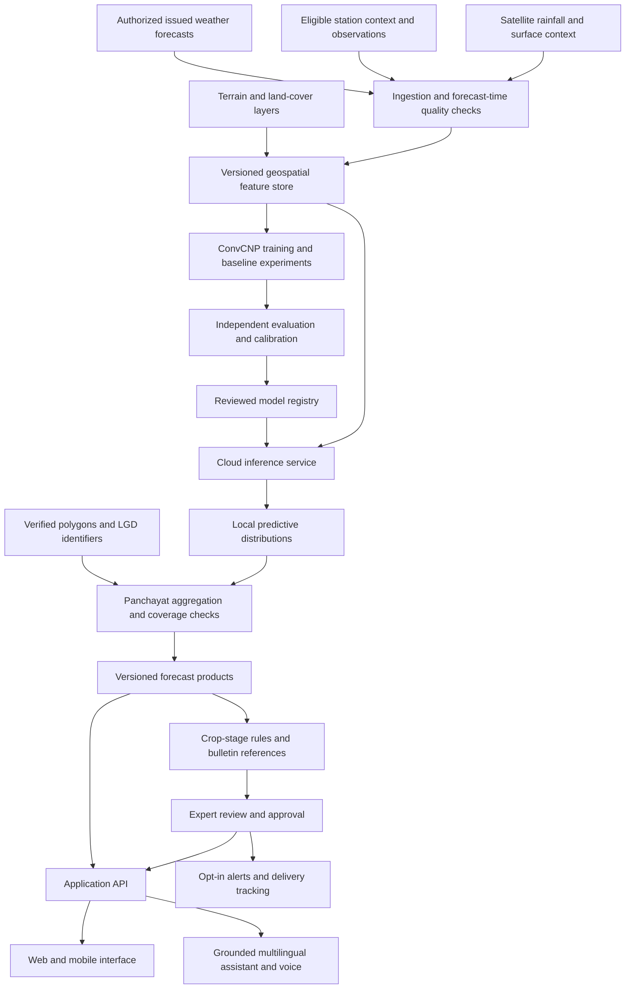

# HoneyBager · PSID 26074 · Team ID 133270

## MeghSetu

### Weather intelligence, closer to every Panchayat.

MeghSetu's solution design connects block-level weather forecasts with local geography, probabilistic machine learning and crop-stage knowledge to support decisions at the Gram Panchayat level. The focus is practical: understand where weather conditions may differ, communicate uncertainty, and turn forecasts into clear agricultural guidance in the user's language.

**This README describes the complete system design, feature scope and technical methodology.**


| Identity | Details |
| --- | --- |
| **Team name** | **HoneyBager** |
| **Problem Statement ID** | **26074 / PS26074** |
| **Team ID** | **133270** |
| Solution | MeghSetu |
| Challenge organization | Ministry of Earth Sciences (MoES) |
| Department | India Meteorological Department (IMD) |
| Category | Software |
| Theme | Agriculture, FoodTech & Rural Development |

**Problem statement:** Downscaling of weather forecast from Block level to Panchayat level: inferring high-resolution plots, data, information and variables from low-resolution inputs for agro-meteorological advisory services.

The organization and department above identify the challenge owner; they do not imply government endorsement of this repository. The hero image is conceptual artwork.

[Solution](#solution-approach) · [Features](#feature-scope) · [Architecture](#system-architecture) · [Algorithms](#algorithms-and-methodology) · [Tech stack](#technology-stack) · [Research](#research-and-technical-references)

## Why MeghSetu

Weather information becomes useful when people can relate it to their own fields, crops and operations. A block covers places with different elevations, land cover, exposure and rainfall patterns. A single forecast value may not express those local differences or the uncertainty surrounding them.

MeghSetu addresses three connected needs:

- **Spatial relevance:** connect large-area forecasts to local conditions and verified Panchayat geography.
- **Decision relevance:** interpret weather in the context of crop stage and agricultural operations.
- **Accessible delivery:** present the result through maps, simple explanations, local languages, voice and reviewed alerts.

The aim is measurable added value. More map pixels alone do not establish better weather predictions; local outputs need independent evaluation, explicit geographic support and calibrated uncertainty.

## Solution approach

The complete workflow connects weather science, geospatial processing and agricultural communication:

1. **Acquire and preserve:** collect authorized forecast products and their issue time, valid time, lead time, units, geographic support and source version.
2. **Build local context:** align terrain, land cover, eligible satellite information and available observations in a versioned cloud feature store.
3. **Downscale probabilistically:** condition a spatial model on those inputs and estimate weather distributions at local target coordinates.
4. **Summarize by Panchayat:** aggregate predictions within verified administrative polygons, retaining coverage and uncertainty information.
5. **Interpret for agriculture:** combine forecast indicators with crop, growth stage, local bulletin references and approved agronomic rules.
6. **Review and communicate:** support expert review, multilingual explanations, voice access, downloadable products and opt-in alert delivery.
7. **Evaluate and improve:** compare with independent observations and baselines, monitor changing conditions, and track model and calibration versions.

## Feature scope

| Module | Product responsibility |
| --- | --- |
| **Panchayat forecast explorer** | Location discovery, local rainfall and temperature outlooks, uncertainty indicators, issue/valid times and geographic context. |
| **Block-to-Panchayat comparison** | Side-by-side source and local products with clearly stated point or area support and differences across lead times. |
| **Downscaling workspace** | Traceable model jobs, input eligibility checks, coarse-to-fine views, model versions and resulting forecast artifacts. |
| **Satellite and terrain intelligence** | Rainfall-context layers, elevation, land-cover features, quality masks, acquisition times and data provenance. |
| **Administrative boundary management** | Verified Panchayat polygons, LGD identifier mapping, coverage checks and reproducible spatial aggregation. |
| **Crop advisory planner** | Crop-stage context, weather-sensitive planning windows, understandable rule reasoning and local bulletin references. |
| **Multilingual assistant** | Questions about the selected forecast and agricultural context, with source-linked explanations in Indian languages. |
| **Voice access** | Speech transcription and spoken guidance for users who prefer conversation over reading. |
| **Village alerts** | Reviewed message templates, opt-in subscriptions, SMS/WhatsApp delivery status and an audit trail. |
| **Model evidence centre** | Baseline comparisons, geographic and chronological holdouts, reliability, uncertainty coverage and model release history. |
| **Officer review console** | Review, approval, withdrawal and revision of advisories with attributable decisions. |
| **Exports and integration** | Downloadable forecast tables, maps and advisory records; versioned APIs for approved downstream services. |

### User journeys

| User | Intended journey |
| --- | --- |
| Farmer | Select a Panchayat → understand the forecast → choose crop and stage → review guidance → ask or listen in a preferred language. |
| Panchayat or extension worker | Review local conditions → inspect the basis of an advisory → share approved information with subscribed users. |
| Forecaster or agricultural expert | Inspect inputs and uncertainty → compare with the source forecast → approve or revise guidance. |
| System administrator | Manage source access, boundaries, service health, model versions and delivery controls. |

## System architecture



### Separation of responsibilities

**Cloud data workers** handle raster preparation, source synchronization, quality checks and feature generation. **Model workers** handle training, calibration and scheduled inference. **Spatial services** handle polygon validation and area aggregation. **Application services** expose results, explanations, review workflows and delivery controls.

This division keeps long-running satellite and model jobs outside the browser and web-request lifecycle. The frontend consumes versioned results and job-status events. Numerical weather values originate in the forecast pipeline; language models explain supplied evidence rather than generate the underlying weather field.

## Algorithms and methodology

### 1. Forecast-time data preparation

Every training example pairs an **issued forecast** with an observation at the corresponding valid time. Inputs include forecast lead time, seasonal descriptors, eligible local context and quality flags. Observations from the future verification period belong in the training target, not in the operational input.

Use satellite acquisition and publication times to enforce availability at the forecast issue time. Fit transformations and feature-selection steps only on the training split. Keep calibration and final evaluation separate. Reanalysis can support exploratory experiments, but performance on reanalysis alone does not establish performance on operational forecasts.

A block value must retain its meaning: area mean, representative point or another published summary. It must not be expanded into a fictitious grid of independent observations. Access to appropriate forecast archives, surrounding spatial context and independent observations is a prerequisite for a defensible downscaling experiment.

### 2. Terrain-conditioned ConvCNP

The main model candidate is a **convolutional conditional neural process (ConvCNP)**. It maps spatial context to a predictive distribution queried at target coordinates. The published downscaling approach combines coarse predictors with local topography, uses Gaussian temperature outputs and Bernoulli–Gamma precipitation outputs, and trains through negative log likelihood. It provides the scientific starting point for MeghSetu's local weather model. [Research paper](https://gmd.copernicus.org/articles/15/251/2022/)

**DeepSensor with PyTorch** is the selected research framework. Its neural-process tooling supports gridded and irregular context, multiple input sets and queries at arbitrary locations. SetConv encodes context values and observation density onto an internal grid; convolutional processing and a target decoder produce local distributions. The rainfall likelihood requires explicit configuration or implementation because the default ConvCNP uses Gaussian marginals. [DeepSensor model documentation](https://alan-turing-institute.github.io/deepsensor/user-guide/convnp.html)

The model design uses:

- **Dynamic predictors:** eligible coarse forecast fields, lead time, seasonal information and observations available at issue time.
- **Static/local predictors:** elevation, slope, topographic position and land-cover descriptors.
- **Outputs:** local temperature mean and spread, rain occurrence probability and positive-rain amount distribution.

For a precipitation head with Gamma shape `k` and scale `theta`:

```text
P(R = 0)       = 1 - p_wet
R | R > 0      ~ Gamma(k, theta)
Expected rain  = p_wet × k × theta
Temperature    ~ Normal(mu, sigma²)
```

Define the wet-day threshold and trace-rain treatment before training. Evaluate tail behavior, sparse-data regions and consistency between weather variables. Distribution choice and model capacity are experimental decisions, not assumptions of guaranteed accuracy.

### 3. XGBoost and statistical baselines

**XGBoost remains a comparison model** for tabular local predictors, bias correction and rain occurrence/amount experiments. It is a practical benchmark against which the neural-process approach must justify its additional complexity. [XGBoost documentation](https://xgboost.readthedocs.io/en/stable/)

The evaluation set includes the unmodified coarse forecast, suitable interpolation, training-only statistical bias correction and XGBoost. Each method uses the same eligible inputs, forecast times and held-out targets. Model selection considers calibration, error, latency, training-data needs and operating cost.

### 4. Cloud geospatial processing

The geospatial workflow derives terrain descriptors, land-cover fractions and eligible rainfall context. Each feature artifact records its source, version, timestamp, projection, resolution and quality mask. Resampling depends on the variable: categorical land cover and accumulated precipitation require different treatment.

High-resolution input layers provide local context. A 10 m land-cover raster or 30 m elevation raster does not, by itself, demonstrate weather forecast skill at those resolutions. Output spacing is a computational choice; useful forecast resolution must be established by validation.

### 5. Panchayat aggregation

Predictions are evaluated on cells intersecting a verified Panchayat polygon. Intersection areas are measured in an appropriate projected coordinate system:

```text
weight_i       = area(cell_i ∩ Panchayat) / area(Panchayat)
Panchayat mean = sum(weight_i × local expected value_i)
```

Report incomplete spatial coverage explicitly. A mean normalized over covered cells is a partial-area result, not automatically a full-Panchayat forecast. Administrative identifiers come from a verified mapping; identifier availability alone does not validate polygon geometry.

Pointwise uncertainty cannot be turned into area uncertainty by averaging quantiles or assuming independent neighbouring cells. The design calls for spatially dependent predictive samples or a separately calibrated area-level method with a defensible area reference. One station is not the measured mean of an entire Panchayat.

### 6. Uncertainty calibration

Calibration assesses whether forecast intervals and event probabilities agree with observed outcomes. Report interval width, empirical coverage and reliability by lead time, region and season.

**Adaptive conformal inference** is a candidate extension for updating uncertainty intervals as observations arrive and distributions change. It does not guarantee nominal coverage for every Panchayat or extreme event. Its inclusion depends on chronological evaluation and the availability of verification data. [Adaptive conformal inference research](https://proceedings.neurips.cc/paper/2021/hash/0d441de75945e5acbc865406fc9a2559-Abstract.html)

Each forecast product should carry issue/valid times, source identity, input age, model version, calibration version, boundary version and quality flags. Unsupported or stale products are withheld or clearly marked through explicit publication rules.

### 7. Agricultural reasoning and language delivery

Agricultural guidance combines forecast event probabilities with crop stage, approved local rules and bulletin references. The explanation should state the weather condition, the relevant operation, the reason for the guidance and the uncertainty or conditions that affect it.

The assistant receives the selected forecast and approved knowledge context, then produces a concise source-linked explanation. Speech transcription and text-to-speech provide a conversational access layer. Official alerts and agronomic recommendations require their designated review and publication process; a fluent language-model response is not an approval decision.

## What distinguishes the technical approach

| Design decision | Why it matters |
| --- | --- |
| **Probabilistic spatial modelling** | Gives local estimates together with uncertainty instead of presenting a single precise-looking value. |
| **Forecast-time eligibility** | Excludes information that would not have been available when the forecast was issued. |
| **Terrain and surface conditioning** | Incorporates local geographic context into the learning problem. |
| **Administrative-area support** | Defines how point or grid predictions become a Panchayat-level product. |
| **Evidence-based model selection** | Requires gains over strong baselines before promoting a more complex model. |
| **Separation of prediction and explanation** | Keeps weather computation distinct from multilingual assistance. |
| **Reviewable delivery** | Connects advisories to evidence, approval, version history and recipient consent. |

MeghSetu's contribution is the integrated workflow and its application to the problem statement. ConvCNP, XGBoost and conformal inference are established methods; this repository does not claim their invention or unmeasured accuracy gains.

## Technology stack

The following is the complete architecture stack. Research and operational components are design selections; repository installation dependencies are defined separately in `package.json` and `package-lock.json`.

| Layer | Technologies | Responsibility |
| --- | --- | --- |
| Web interface | React, Vite, JavaScript, responsive CSS | Location exploration, forecast workspace, review views and mobile interaction |
| Maps | MapLibre GL JS, geospatial tile services | Geographic layers, administrative context and spatial selection |
| Charts and interaction | Recharts, Motion, SVG, Lucide | Forecast comparison, uncertainty displays, transitions and accessible controls |
| Application API | Node.js, Express | Browser-facing endpoints, provider adapters and request controls |
| Model service | Python, FastAPI, containerized workers | Forecast inference, model jobs and versioned output |
| Probabilistic learning | PyTorch, DeepSensor / neuralprocesses | ConvCNP training and spatial predictive distributions |
| Baselines | XGBoost and statistical methods | Comparative learning and bias-correction experiments |
| Geospatial preparation | Google Earth Engine, GDAL/Rasterio, GeoPandas | Cloud extraction, raster alignment and polygon processing |
| Weather arrays | xarray, Dask, Zarr | Weather cubes, chunked processing and reproducible feature artifacts |
| Spatial database | PostgreSQL / PostGIS | Administrative geometry, spatial joins and aggregation |
| Artifact storage | Object storage and versioned manifests | Forecast products, data lineage and model inputs |
| Experiment tracking | MLflow | Experiments, evaluation records and model registry |
| Language assistance | Perplexity Agent API with controlled forecast context | Source-linked explanations and agricultural reference retrieval |
| Speech | Sarvam speech-to-text and text-to-speech | Indian-language voice interaction |
| Web deployment | Netlify, Netlify Functions, Netlify Blobs | Web hosting, application endpoints and lightweight shared context |
| Model infrastructure | Separate cloud compute and scheduled workers | Training and geospatial workloads outside web-function limits |
| Notifications | Approved SMS/WhatsApp provider adapters | Opt-in delivery and status tracking |
| Verification | Node test runner, integration checks, browser tests and model evaluation | Software behavior and independently assessed forecast quality |

## Data and integration design

| Source | Intended role | Important distinction |
| --- | --- | --- |
| [IMD products and interfaces](https://api.imd.gov.in/public/api_reference.html) | Authorized operational inputs and forecast archive integration | Confirm product permissions, time semantics and archive availability. |
| Station observations | Training targets and independent verification; eligible lagged context | Respect reporting latency, quality and target/context separation. |
| [NASA/USGS SRTM](https://developers.google.com/earth-engine/datasets/catalog/USGS_SRTMGL1_003) | Approximately 30 m elevation and derived terrain features | Static context, not a promise of 30 m weather accuracy. |
| [ESA WorldCover v200](https://developers.google.com/earth-engine/datasets/catalog/ESA_WorldCover_v200) | 10 m land-cover classes for 2021 | Surface context, not a live crop-stage measurement. |
| [NASA GPM IMERG](https://gpm.nasa.gov/data/imerg) | Satellite rainfall estimates and historical context | Preserve latency, run/version identity and observation uncertainty. |
| [Local Government Directory](https://lgdirectory.gov.in/) | Administrative identifiers and hierarchy | Verify polygon provenance and identifier mapping separately. |
| [IMD KALP](https://mausam.imd.gov.in/imd_latest/contents/agromet/kalp/kalp.pdf) | Crop-stage guidance reference | Regional interpretation and approval belong with domain experts. |
| [Open-Meteo](https://open-meteo.com/en/docs) | Numerical weather and geocoding integration | Preserve provider attribution and distinguish model values from observations. |

## Evaluation and release criteria

Use chronological holdouts and separate geographic/station holdouts, with model selection and calibration kept away from the final test set. Include monsoon and dry periods, different terrains, sparse-data areas and multiple forecast lead times.

| Question | Evidence to require |
| --- | --- |
| Are local estimates better than the source and baselines? | Matched-support MAE, RMSE and bias against independent observations |
| Are probabilities useful? | CRPS, rain-event Brier scores and reliability diagrams |
| Are intervals credible? | Coverage and width by region, season and lead time |
| Which data sources improve results? | Controlled terrain, land-cover and satellite ablations |
| Are Panchayat products geographically sound? | Polygon provenance, coverage and area-reference checks |
| Does the service operate reliably? | Input freshness, failure behavior, latency and cost measurements |
| Is guidance understandable and useful? | Structured review with farmers, extension workers and agricultural experts |

A model release should retain its training-data manifest, split definitions, metrics, calibration artifact and approval record. Geographic resolution and percentage improvements should be stated only when these evaluations support them.

## Reliability, access and governance

The system design includes authenticated operational roles, least-privilege service access, server-side credentials, rate and spending controls, input validation, observable job status and audit records. Monitoring covers data availability, forecast freshness, drift, calibration, delivery failures and source changes.

Alert subscriptions require consent and a withdrawal mechanism. Retention rules apply to forecasts, conversations and recordings. Public explanations should distinguish a source forecast, a derived forecast and an approved advisory, and retain the provenance needed to review each one.

## Repository documentation

- [Development and local setup](docs/DEVELOPMENT.md)
- [Netlify deployment guide](docs/NETLIFY_DEPLOY.md)
- [Environment-variable template](.env.example)
- [Application dependencies and commands](package.json)

The source is organized into `src/` for the web interface, `server/` for application APIs, `netlify/functions/` for deployment entry points, `public/assets/` for artwork and `tests/` for software checks.

## Research and technical references

- Vaughan et al. (2022), [Convolutional conditional neural processes for local climate downscaling](https://gmd.copernicus.org/articles/15/251/2022/).
- Alan Turing Institute, [DeepSensor documentation](https://alan-turing-institute.github.io/deepsensor/) and [source code](https://github.com/alan-turing-institute/deepsensor).
- Gibbs and Candès (2021), [Adaptive Conformal Inference Under Distribution Shift](https://proceedings.neurips.cc/paper/2021/hash/0d441de75945e5acbc865406fc9a2559-Abstract.html).
- [XGBoost documentation](https://xgboost.readthedocs.io/en/stable/) and [Google Earth Engine guides](https://developers.google.com/earth-engine/guides).
- [IMD API reference](https://api.imd.gov.in/public/api_reference.html), [IMD KALP](https://mausam.imd.gov.in/imd_latest/contents/agromet/kalp/kalp.pdf) and [Local Government Directory](https://lgdirectory.gov.in/).
- [SRTM elevation](https://developers.google.com/earth-engine/datasets/catalog/USGS_SRTMGL1_003), [ESA WorldCover](https://developers.google.com/earth-engine/datasets/catalog/ESA_WorldCover_v200) and [NASA GPM IMERG](https://gpm.nasa.gov/data/imerg).

Artwork is generated illustration; map data and third-party packages retain their source attribution and licenses. See the development guide for asset details.

**HoneyBager · MeghSetu · PS26074 · Team 133270**
